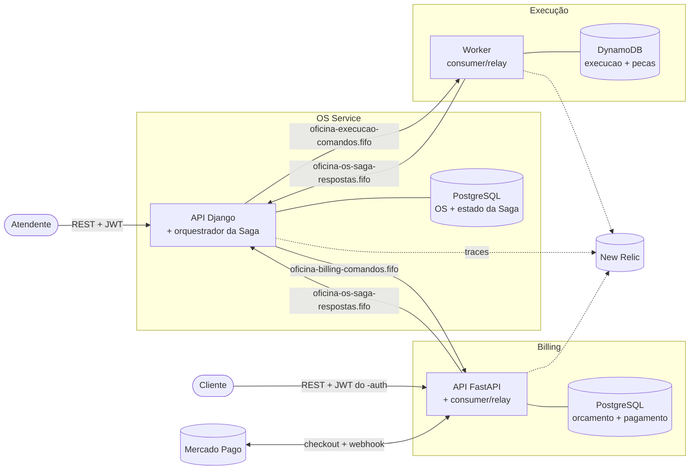

# Oficina — Saga da Ordem de Serviço (Tech Challenge FIAP, Fase 4)

Contrato de mensagens, documentação e testes ponta a ponta da **Saga orquestrada** que liga OS Service, Billing e Execução.

> **Status: contrato v1.1.0** (tag [`v1.1.0`](https://github.com/helyomendesdev/tech-challenge-oficina-saga/releases/tag/v1.1.0): reserva por item e peças consumidas, [ADR-004](docs/adr-004-pecas-consumidas.md)). Pontos ainda em aberto em [`docs/questoes-abertas.md`](docs/questoes-abertas.md).

## Arquitetura

Três microsserviços, cada um com repositório, pipeline e banco próprios; nenhum acessa o banco de outro. Eles conversam só por filas SQS FIFO (comando e resposta) e, quando há usuário do outro lado, por REST.



| Serviço | Repositório | Banco | Papel na Saga |
|---|---|---|---|
| OS Service | [tech-challenge-oficina-os](https://github.com/helyomendesdev/tech-challenge-oficina-os) | PostgreSQL (SQL) | Abre a OS, **orquestra** a Saga, guarda estado e histórico, expõe a consulta |
| Billing | [tech-challenge-oficina-billing](https://github.com/helyomendesdev/tech-challenge-oficina-billing) | PostgreSQL (SQL) | Gera orçamento, recebe a aprovação do cliente, cobra e estorna no Mercado Pago |
| Execução | [tech-challenge-oficina-execution](https://github.com/helyomendesdev/tech-challenge-oficina-execution) | DynamoDB (NoSQL) | Reserva/consome peças, executa os serviços, comunica a finalização |
| Saga (este repo) | [tech-challenge-oficina-saga](https://github.com/helyomendesdev/tech-challenge-oficina-saga) | — | Contrato das mensagens, kit de tracing, BDD ponta a ponta, stack local |

Infraestrutura compartilhada (VPC, EKS, ALB, ECR) em [tech-challenge-oficina-k8s](https://github.com/helyomendesdev/tech-challenge-oficina-k8s) e banco gerenciado em [tech-challenge-oficina-database](https://github.com/helyomendesdev/tech-challenge-oficina-database). Pipeline, cobertura de testes e Swagger de cada serviço estão no README do próprio repositório.

## Por que Saga orquestrada

Decisão completa em [ADR-001](docs/adr-001-saga-orquestrada.md). Em resumo:

- **O fluxo é linear e curto** (orçamento → aprovação → pagamento → execução) e a **compensação** é a parte crítica. Com um orquestrador, a sequência e o que desfazer ficam numa máquina de estados só ([`contrato/saga-estados.yaml`](contrato/saga-estados.yaml)), em vez de espalhados pelos assinantes de eventos.
- **O orquestrador mora dentro do OS Service**, porque a OS já é dona do ciclo de vida e do status; um quarto serviço só para guardar esse estado não se paga.
- **Participantes não se conhecem**: Billing e Execução recebem comando e respondem, sem saber da Saga.
- **Visibilidade**: o estado e o histórico de cada Saga são consultáveis (`GET /api/v1/ordens-servico/{id}/saga/`), e o trace distribuído liga os três serviços no New Relic.

Compensação, na ordem inversa do que já foi feito ([diagramas](docs/fluxo-saga.md#compensação)):

| Falha | O orquestrador desfaz |
|---|---|
| Orçamento falhou, ou cliente recusou | nada (Saga cancelada) |
| Pagamento recusado | `CancelarOrcamento` |
| Cliente não respondeu no prazo ([ADR-003](docs/adr-003-timeout-de-aprovacao.md)) | `CancelarOrcamento` |
| Execução falhou ao iniciar | `EstornarPagamento` → `CancelarOrcamento` |
| Execução falhou em andamento, ou cliente cancelou | `CancelarExecucao` → `EstornarPagamento` → `CancelarOrcamento` |

Garantias: filas FIFO com `MessageGroupId = sagaId` (ordem por Saga), idempotência por `messageId` em todos os consumidores, outbox nos participantes (a resposta é gravada junto com a mudança de estado e publicada por um relay) e DLQ em cada fila. O pagamento é passo próprio da Saga, antes da execução ([ADR-002](docs/adr-002-pagamento-antes-da-execucao.md)).

## Observabilidade

Os três serviços rodam com o agente Python do New Relic (o mesmo da Fase 3) quando `NEW_RELIC_LICENSE_KEY` está definida. O contexto W3C (`traceparent`/`tracestate`) viaja nos MessageAttributes do SQS ([`tracing/propagacao-sqs.md`](tracing/propagacao-sqs.md)) e cada consumidor o aceita numa transação de background, então **uma Saga é um trace só**: da abertura HTTP no OS Service, passando pelo consumo dos comandos no Billing e na Execução, até o consumo das respostas no orquestrador. O `traceId` de cada mensagem também fica no histórico da consulta da Saga.

Para achar o trace de uma OS no New Relic, pegue o `traceId` da consulta da Saga e rode:

```sql
SELECT count(*) FROM Transaction WHERE traceId = '<traceId>' FACET appName, name SINCE 1 day ago
```

Painel pronto e outras consultas NRQL (mensagens por tipo, compensações, DLQs) em [`observabilidade/`](observabilidade/consultas-nrql.md).

## O que tem aqui

| Caminho | Conteúdo |
|---|---|
| [`contrato/asyncapi.yaml`](contrato/asyncapi.yaml) | Contrato AsyncAPI 3.0: filas, comandos, respostas, DLQs |
| [`contrato/schemas/`](contrato/schemas) | JSON Schema (draft-07): `envelope`, `comum`, um schema por mensagem em `comandos/` e `respostas/` |
| [`contrato/exemplos/`](contrato/exemplos) | Um exemplo válido por mensagem; `invalidos/` tem exemplos que **devem** ser rejeitados |
| [`contrato/saga-estados.yaml`](contrato/saga-estados.yaml) | Tabela de transições do orquestrador (estados, gatilhos, comandos enviados); conferida pelo validador |
| [`contrato/os-consulta-saga.openapi.yaml`](contrato/os-consulta-saga.openapi.yaml) | Rota de consulta da Saga que o `-os` implementa (`GET /api/v1/ordens-servico/{id}/saga/`); é por onde o BDD contra a stack real observa o histórico |
| [`contrato/billing-aprovacao.openapi.yaml`](contrato/billing-aprovacao.openapi.yaml) | Rota de aprovação do orçamento que o Billing implementa |
| [`oficina_saga/`](oficina_saga) | Pacote Python: rastreio W3C (`rastreio`), adaptador do agente New Relic (`newrelic_adapter`), envelope (`envelope`) e carga da máquina de estados (`maquina`) |
| [`tests/`](tests) | Testes do pacote, do criador de filas, do painel, das rotas OpenAPI e do motor da stack real |
| [`stack/`](stack) | `docker-compose.yml` com os três serviços + LocalStack, `criar_filas.py` (filas e DLQs do AsyncAPI) e [`variaveis.md`](stack/variaveis.md) |
| [`observabilidade/`](observabilidade) | Painel do New Relic (`painel-saga.json`) e consultas NRQL |
| [`scripts/validar_contrato.py`](scripts/validar_contrato.py) | Valida exemplos contra schemas e a coerência de nomes com o AsyncAPI; também confere a máquina de estados com o diagrama de `docs/fluxo-saga.md` e as trilhas de exemplo |
| [`docs/adr-001-saga-orquestrada.md`](docs/adr-001-saga-orquestrada.md) | Por que orquestrada, e por que o orquestrador mora no OS Service |
| [`docs/adr-002-pagamento-antes-da-execucao.md`](docs/adr-002-pagamento-antes-da-execucao.md) | Por que o pagamento é passo próprio da Saga, antes da execução, com estorno separado |
| [`docs/adr-003-timeout-de-aprovacao.md`](docs/adr-003-timeout-de-aprovacao.md) | Quem dispara o timeout de aprovação, o prazo e a compensação |
| [`docs/fluxo-saga.md`](docs/fluxo-saga.md) | Diagramas: fluxo feliz, compensação, máquina de estados, mapa para o status da OS |
| [`tracing/propagacao-sqs.md`](tracing/propagacao-sqs.md) | `traceparent`/`tracestate` em MessageAttributes do SQS; `requestId` no envelope |
| [`tracing/newrelic-agente.md`](tracing/newrelic-agente.md) | API de distributed tracing do agente Python do New Relic (9.13.0): funções, `transport_type`, headers emitidos |
| [`e2e/`](e2e) | BDD ponta a ponta (pytest-bdd) com dois motores: referência e stack real |

## Mensagens

Envelope comum a todas: `messageId` (chave de idempotência), `type`, `version`, `sagaId`, `osId`, `causationId`, `requestId`, `occurredAt`, `payload`.

| Fila FIFO (+ DLQ `…-dlq.fifo`) | Quem consome | Mensagens |
|---|---|---|
| `oficina-billing-comandos.fifo` | Billing | `GerarOrcamento`, `CancelarOrcamento`, `SolicitarPagamento`, `EstornarPagamento` |
| `oficina-execucao-comandos.fifo` | Execução | `IniciarExecucao`, `CancelarExecucao` |
| `oficina-os-saga-respostas.fifo` | OS Service (orquestrador) | `OrcamentoGerado`, `OrcamentoFalhou`, `OrcamentoAprovado`, `OrcamentoRecusado`, `OrcamentoCancelado`, `PagamentoConfirmado`, `PagamentoFalhou`, `PagamentoEstornado`, `ExecucaoIniciada`, `ExecucaoFalhou`, `ExecucaoFinalizada`, `ExecucaoCancelada` |

Todo envio usa `MessageGroupId = sagaId` e `MessageDeduplicationId = messageId`.

## Usar o pacote num serviço

Cada mudança do contrato gera uma tag nova; instale pela tag:

```bash
pip install "oficina-saga[newrelic,validacao] @ git+https://github.com/helyomendesdev/tech-challenge-oficina-saga@refs/tags/v1.1.0"
```

O extra `newrelic` só traz o agente; sem ele o adaptador cai no W3C puro de `oficina_saga.rastreio`. Detalhes de propagação em [`tracing/propagacao-sqs.md`](tracing/propagacao-sqs.md).

Produtor: monta o envelope, grava os atributos de correlação na transação e envia com o contexto W3C nos MessageAttributes (o header proprietário `newrelic` fica de fora).

```python
import json

from oficina_saga import envelope as env
from oficina_saga import newrelic_adapter

msg = env.montar(
    "GerarOrcamento",
    saga_id="291be3b9-8b0d-583e-94c1-f9d2ae911fb3",
    os_id=101,
    request_id="req-feliz-947a90",
    payload={"clienteId": 7, "veiculoId": 15,
             "servicos": [{"servicoId": 12, "quantidade": 1}],
             "pecas": [{"pecaId": 40, "quantidade": 2}]},
)
newrelic_adapter.registrar_mensagem(msg)
sqs.send_message(
    QueueUrl=fila,
    MessageBody=json.dumps(msg),
    MessageAttributes=newrelic_adapter.atributos_para_envio(),
    MessageGroupId=msg["sagaId"],
    MessageDeduplicationId=msg["messageId"],
)
```

Consumidor: pede os atributos no `receive_message`, aceita o contexto recebido (`transport_type="Queue"`) e registra a correlação.

```python
import json

from oficina_saga import newrelic_adapter

resposta = sqs.receive_message(
    QueueUrl=fila, MessageAttributeNames=["traceparent", "tracestate"]
)
for m in resposta.get("Messages", []):
    newrelic_adapter.aceitar_recebido(m.get("MessageAttributes"))
    recebido = json.loads(m["Body"])
    newrelic_adapter.registrar_mensagem(recebido)
    ...  # processa
```

O pacote instalado leva os schemas e o `saga-estados.yaml` dentro dele (`oficina_saga._contrato`), então `envelope.validar` e `maquina.carregar` funcionam no serviço sem cópia do repositório. O extra `validacao` traz o `jsonschema` e o `PyYAML` que essas duas funções usam; `montar` e o rastreio só usam a biblioteca padrão.

## BDD

O `.feature` ([`e2e/features/fluxo_os.feature`](e2e/features/fluxo_os.feature)) roda contra um de dois motores, escolhido por `SAGA_E2E_DRIVER`:

| Motor | Como | Onde roda | Cenários |
|---|---|---|---|
| `referencia` (padrão) | Máquina do contrato em memória; o motor provoca a resposta de cada participante | CI de todo PR ([`ci.yml`](.github/workflows/ci.yml)) | os quatro |
| `stack-real` | Serviços de verdade pelas filas; o motor só abre a OS, aprova o orçamento e espera o histórico da rota de consulta da Saga | Workflow manual [`e2e-stack-real.yml`](.github/workflows/e2e-stack-real.yml) | os três marcados `@stack-real` |

O cenário de mensagem repetida só roda na referência: ele depende de reentregar uma resposta com o mesmo `messageId`, e a stack real não provoca reentrega do SQS. Contra a stack real ele é pulado por desenho, não por falha.

O motor de referência é a especificação executável: carrega a mesma tabela (`contrato/saga-estados.yaml`) que o orquestrador do `-os` pode carregar. Não é um segundo orquestrador.

Variáveis do motor `stack-real` (todas opcionais):

| Variável | Padrão | Para que serve |
|---|---|---|
| `SAGA_E2E_OS_URL` | `http://localhost:8000` | Base do OS Service |
| `SAGA_E2E_BILLING_URL` | `http://localhost:8001` | Base do Billing (aprovação do orçamento) |
| `SAGA_E2E_TOKEN` | vazia | JWT Bearer de reserva, usado onde o login do atendente / a chave do cliente não estão configurados; vazio = sem cabeçalho `Authorization` |
| `SAGA_E2E_ATENDENTE_USERNAME` / `SAGA_E2E_ATENDENTE_PASSWORD` | `atendente.demo` / vazia | Login do atendente no `-os` (`/api/v1/auth/token/`); o Bearer vai na abertura, na leitura da OS e na consulta da Saga |
| `SAGA_E2E_CLIENTE_CHAVE_PRIVADA` | vazia | Caminho do PEM de teste (gerado por `stack/gerar_chaves_e2e.py`) com que o driver assina o JWT do cliente na aprovação do Billing |
| `SAGA_E2E_SIMULAR_PAGAMENTO_CMD` | vazia | Comando que confirma o pagamento no Billing fake; sem ele o motor só espera |
| `SAGA_E2E_EXECUCAO_CLI` | vazia | Prefixo que roda a CLI do Execution (`docker compose exec -T execucao ...` ou `kubectl exec ... --`); o driver inicia e finaliza cada serviço por ela. Sem ele o motor só espera |
| `SAGA_E2E_TIMEOUT_S` | `60` | Quanto esperar cada passo aparecer no histórico |
| `SAGA_E2E_INTERVALO_S` | `1` | Intervalo entre consultas |

As variáveis dos serviços da stack (filas, AWS, New Relic) estão em [`stack/variaveis.md`](stack/variaveis.md).

## Rodar localmente

```bash
python -m venv .venv
# Windows: .venv\Scripts\activate   |   Linux/macOS: source .venv/bin/activate
pip install -r requirements.txt

python scripts/validar_contrato.py                   # exemplos x schemas x AsyncAPI
pytest -q                                            # tests/ + e2e/ (pytest.ini), BDD no motor de referência
docker compose -f stack/docker-compose.yml config    # confere o compose da stack
```

Para subir a stack e rodar o BDD contra ela:

```bash
python stack/gerar_chaves_e2e.py   # chave de teste e senhas aleatorias em stack/.local/ (fora do git)
docker compose --env-file stack/.local/e2e.env -f stack/docker-compose.yml up -d --build --wait
set -a; . stack/.local/e2e.env; set +a
export SAGA_E2E_DRIVER=stack-real
export SAGA_E2E_SIMULAR_PAGAMENTO_CMD='docker compose --env-file stack/.local/e2e.env -f stack/docker-compose.yml exec -T billing python -m billing_service.cli simulate-payment --payment-id {payment_id} --outcome {outcome}'
export SAGA_E2E_EXECUCAO_CLI='docker compose --env-file stack/.local/e2e.env -f stack/docker-compose.yml exec -T execucao python -m execution_service.cli'
pytest -q e2e
```

Com `NEW_RELIC_LICENSE_KEY` exportada antes do `up`, os três serviços sobem sob o agente e o trace aparece no New Relic. Para testar a branch de um PR antes do merge, use `OS_GIT_URL`/`OS_GIT_REF`, `BILLING_GIT_URL`/`BILLING_GIT_REF` e `EXECUTION_GIT_URL`/`EXECUTION_GIT_REF`; detalhes e problemas conhecidos em [`stack/variaveis.md`](stack/variaveis.md). O mesmo roteiro roda no workflow manual [`e2e-stack-real.yml`](.github/workflows/e2e-stack-real.yml).

A validação do AsyncAPI usa o CLI oficial via `npx` (versão fixada em [`.github/workflows/ci.yml`](.github/workflows/ci.yml)). A CI roda os mesmos passos e ainda falha se o `.feature` tiver step sem definição.

## Mudando o contrato

1. Altere o schema em `contrato/schemas/` e o exemplo em `contrato/exemplos/`.
2. Mensagem nova: entra no `enum` de `type` do envelope, ganha schema, exemplo e entrada em `components.messages` do AsyncAPI — o validador recusa se faltar qualquer um dos quatro.
3. Mudança incompatível sobe `version` da mensagem.

## Divisão do grupo

| Pessoa | Parte |
|---|---|
| Hélio | OS Service (com o orquestrador) e template de CI |
| Lucas | Billing, Mercado Pago, JWT |
| Sophia | Execução (NoSQL), infra, SQS, Terraform |
| Luís | Contrato da Saga, tracing distribuído, BDD ponta a ponta |
