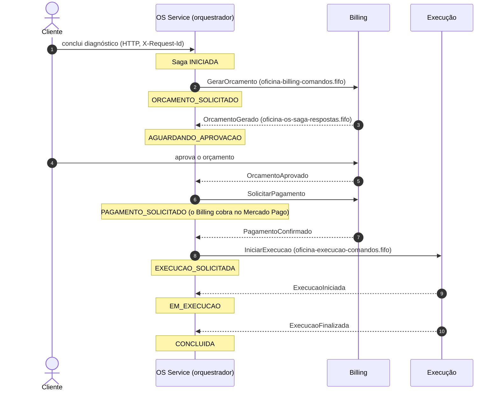
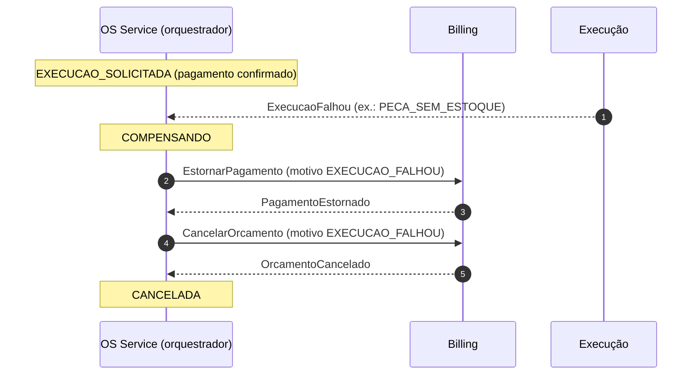
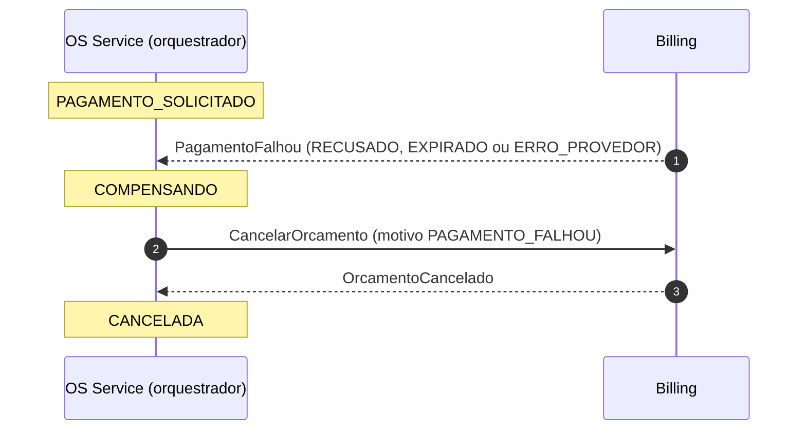
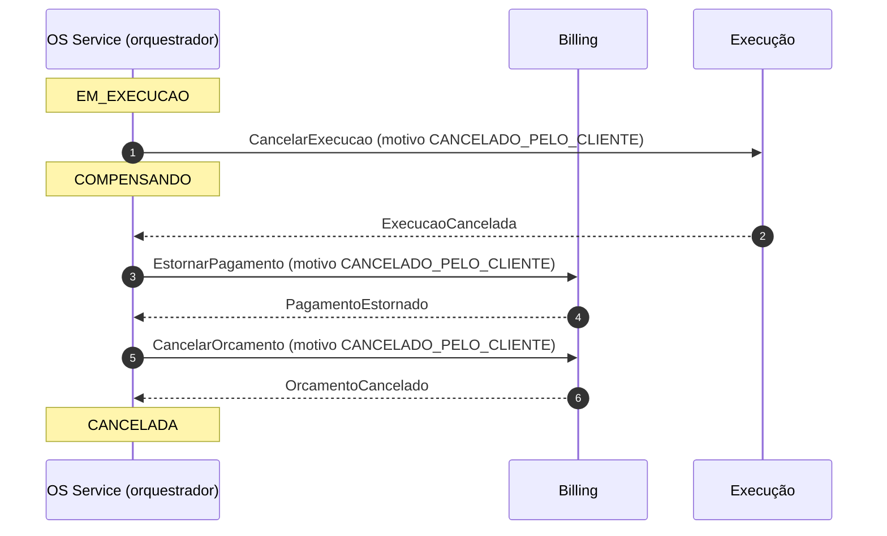

# Fluxo da Saga da Ordem de Serviço (v1)

Orquestrador: OS Service ([ADR-001](adr-001-saga-orquestrada.md)). Mensagens: [`contrato/asyncapi.yaml`](../contrato/asyncapi.yaml).

## Fluxo feliz

## Compensação

Falha **depois** de o orçamento existir desfaz o que já foi feito, na ordem inversa: execução, pagamento, orçamento.

Variação — o pagamento falha (nada a estornar, só o orçamento é desfeito):

Variação — cancelamento com a execução em andamento:

## Máquina de estados

A fonte das transições é [`contrato/saga-estados.yaml`](../contrato/saga-estados.yaml); o diagrama abaixo é a visualização dela, e `scripts/validar_contrato.py` confere que os dois têm os mesmos pares de transição (estado de origem e de destino). `inicio` e `cancelamento` são gatilhos externos, não mensagens da fila: `inicio` chega por requisição HTTP que abre a Saga, e `cancelamento` é o pedido do cliente com a execução em andamento. O validador também confere o início (`[*]`) e os estados finais do diagrama contra `inicial` e `finais` da tabela. Os rótulos das setas não são conferidos, e o validador também não confere se o código do orquestrador segue a tabela, nem sintaxe Mermaid além da seta simples entre dois estados, a única que ele lê.

```mermaid
stateDiagram-v2
    [*] --> INICIADA
    INICIADA --> ORCAMENTO_SOLICITADO: envia GerarOrcamento
    ORCAMENTO_SOLICITADO --> AGUARDANDO_APROVACAO: OrcamentoGerado
    ORCAMENTO_SOLICITADO --> CANCELADA: OrcamentoFalhou
    AGUARDANDO_APROVACAO --> PAGAMENTO_SOLICITADO: OrcamentoAprovado, envia SolicitarPagamento
    AGUARDANDO_APROVACAO --> CANCELADA: OrcamentoRecusado (em aberto)
    PAGAMENTO_SOLICITADO --> EXECUCAO_SOLICITADA: PagamentoConfirmado, envia IniciarExecucao
    PAGAMENTO_SOLICITADO --> COMPENSANDO: PagamentoFalhou, envia CancelarOrcamento
    EXECUCAO_SOLICITADA --> EM_EXECUCAO: ExecucaoIniciada
    EXECUCAO_SOLICITADA --> COMPENSANDO: ExecucaoFalhou, envia EstornarPagamento
    EM_EXECUCAO --> CONCLUIDA: ExecucaoFinalizada
    EM_EXECUCAO --> COMPENSANDO: ExecucaoFalhou ou cancelamento, envia CancelarExecucao
    COMPENSANDO --> COMPENSANDO: ExecucaoCancelada, envia EstornarPagamento; PagamentoEstornado, envia CancelarOrcamento
    COMPENSANDO --> CANCELADA: OrcamentoCancelado
    CONCLUIDA --> [*]
    CANCELADA --> [*]
```

Regras do orquestrador:

- Resposta que não corresponde a uma transição válida do estado atual **não muda o estado**: é registrada e descartada (entrega repetida, por exemplo reprocessamento da DLQ). Com FIFO por `sagaId`, fora de ordem não acontece dentro de uma Saga.
- Toda transição grava o estado novo e o próximo comando na mesma transação (outbox).
- Comando disparado por gatilho externo (abrir a Saga, cliente cancelar) sai com `causationId` nulo; resposta sempre tem causa, e o `causationId` dela é o `messageId` do comando que responde (`contrato/schemas/envelope.schema.json`).
- `OrcamentoFalhou` não precisa de compensação: nenhum orçamento foi criado.
- `PagamentoFalhou` só desfaz o orçamento (`CancelarOrcamento`, motivo `PAGAMENTO_FALHOU`): nenhum pagamento foi confirmado, então não há estorno.
- A compensação segue a ordem inversa da ida: execução (`CancelarExecucao`), pagamento (`EstornarPagamento`), orçamento (`CancelarOrcamento`). Cada passo só sai depois da confirmação do anterior (`ExecucaoCancelada`, `PagamentoEstornado`).
- Em `COMPENSANDO`, o comando enviado ao entrar no estado (`CancelarOrcamento`, `EstornarPagamento` ou `CancelarExecucao`, conforme a transição) leva o motivo da própria transição (`PAGAMENTO_FALHOU`, `EXECUCAO_FALHOU` ou `CANCELADO_PELO_CLIENTE`). Os comandos dos auto-laços (`EstornarPagamento` após `ExecucaoCancelada`, `CancelarOrcamento` após `PagamentoEstornado`) repetem o motivo com que a compensação foi aberta (`motivo: herdado` na tabela `contrato/saga-estados.yaml`): o orquestrador guarda esse motivo na Saga. O validador exige `herdado` ali porque `COMPENSANDO` é entrado com mais de um motivo.

## Correspondência com o status da OS no monólito

Status de hoje em `atendimento/domain/enums.py` e transições em `atendimento/domain/policies.py` do repositório da Fase 1.

| Estado da Saga | Status da OS (monólito) | Observação |
|---|---|---|
| — (antes da Saga) | `RECEBIDA`, `DIAGNOSTICO` | A Saga começa quando o diagnóstico termina — **em aberto** |
| `INICIADA`, `ORCAMENTO_SOLICITADO`, `AGUARDANDO_APROVACAO`, `PAGAMENTO_SOLICITADO` | `AGUARDANDO` | A OS só passa a `EXECUCAO` depois do pagamento confirmado |
| `EXECUCAO_SOLICITADA`, `EM_EXECUCAO` | `EXECUCAO` | |
| `CONCLUIDA` | `FINALIZADA` | |
| — (depois da Saga) | `ENTREGUE` | Entrega do veículo fica fora da Saga |
| `COMPENSANDO`, `CANCELADA` | `CANCELADA` | |

Esta tabela é conferida pelo validador (`scripts/validar_contrato.py`) contra o bloco `status_os` de `contrato/saga-estados.yaml`.

Divergência a decidir: no monólito, `AGUARDANDO → DIAGNOSTICO` é permitido (recusar o orçamento volta ao diagnóstico, não cancela). Na v1 da Saga, `OrcamentoRecusado` leva a `CANCELADA`. Ver [`questoes-abertas.md`](questoes-abertas.md).
