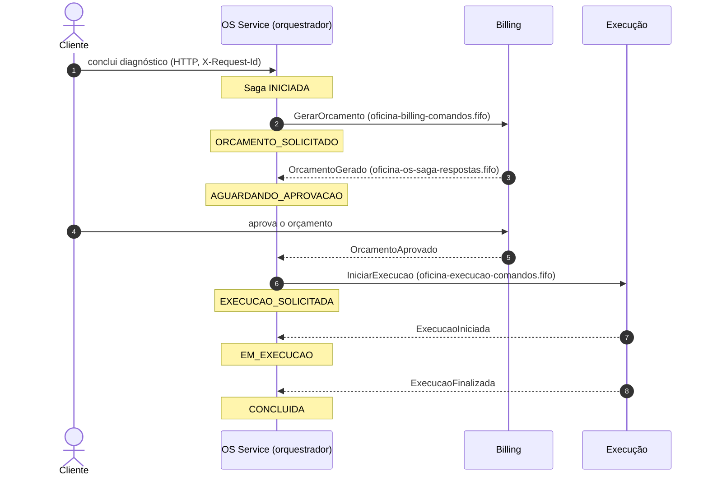
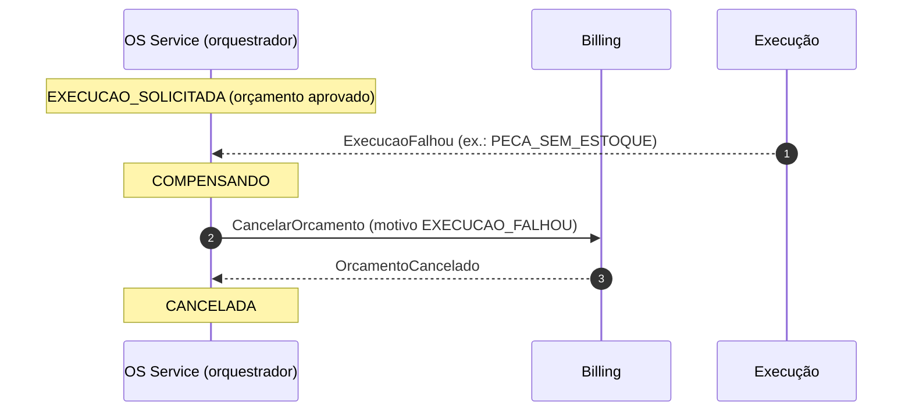
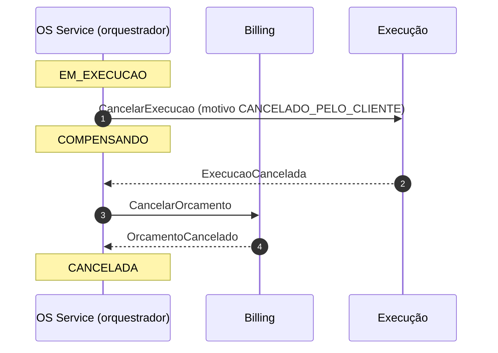
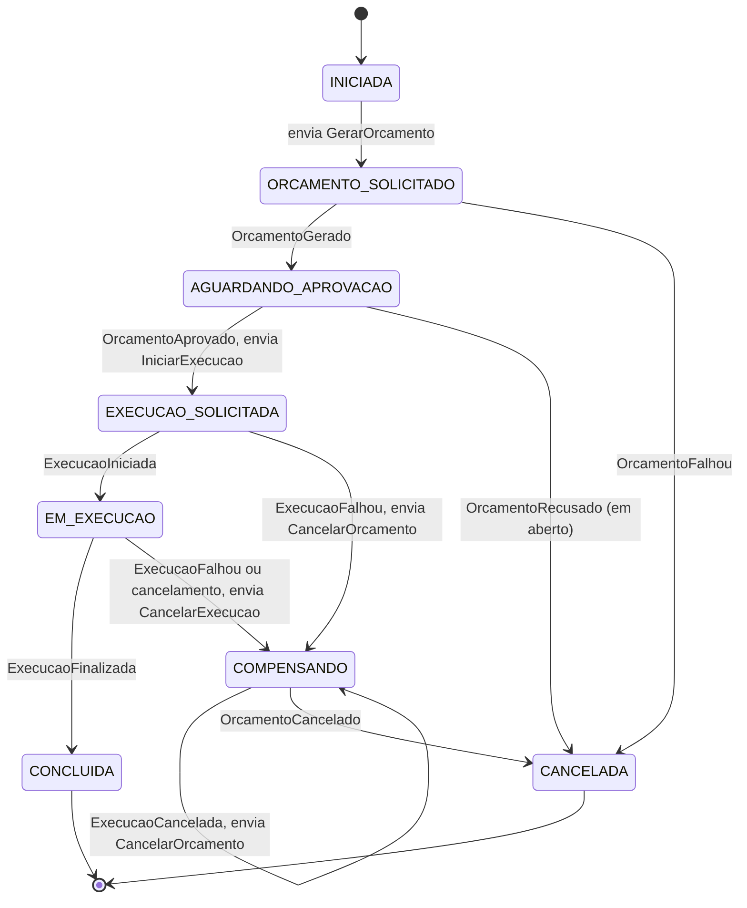

# Fluxo da Saga da Ordem de Serviço (v0.1)

Orquestrador: OS Service ([ADR-001](adr-001-saga-orquestrada.md)). Mensagens: [`contrato/asyncapi.yaml`](../contrato/asyncapi.yaml).

## Fluxo feliz

## Compensação

Falha **depois** de o orçamento existir desfaz o que já foi feito, na ordem inversa.

Variação — cancelamento com a execução em andamento:

## Máquina de estados

Regras do orquestrador:

- Resposta que não corresponde a uma transição válida do estado atual **não muda o estado**: é registrada e descartada (entrega repetida, por exemplo reprocessamento da DLQ). Com FIFO por `sagaId`, fora de ordem não acontece dentro de uma Saga.
- Toda transição grava o estado novo e o próximo comando na mesma transação (outbox).
- `OrcamentoFalhou` não precisa de compensação: nenhum orçamento foi criado.

## Correspondência com o status da OS no monólito

Status de hoje em `atendimento/domain/enums.py` e transições em `atendimento/domain/policies.py` do repositório da Fase 1.

| Estado da Saga | Status da OS (monólito) | Observação |
|---|---|---|
| — (antes da Saga) | `RECEBIDA`, `DIAGNOSTICO` | A Saga começa quando o diagnóstico termina — **em aberto** |
| `INICIADA`, `ORCAMENTO_SOLICITADO`, `AGUARDANDO_APROVACAO` | `AGUARDANDO` | |
| `EXECUCAO_SOLICITADA`, `EM_EXECUCAO` | `EXECUCAO` | |
| `CONCLUIDA` | `FINALIZADA` | |
| — (depois da Saga) | `ENTREGUE` | Entrega do veículo fica fora da Saga |
| `COMPENSANDO`, `CANCELADA` | `CANCELADA` | |

Divergência a decidir: no monólito, `AGUARDANDO → DIAGNOSTICO` é permitido (recusar o orçamento volta ao diagnóstico, não cancela). Na v0.1 da Saga, `OrcamentoRecusado` leva a `CANCELADA`. Ver [`questoes-abertas.md`](questoes-abertas.md).
